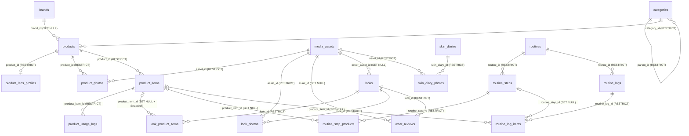

# 妆匣 BeautyBox SQLite Schema V1 设计说明与 ER 关系

- **文档版本**：V1.0（对应 `SQLite Schema V1` / `PRAGMA user_version = 1`）
- **基线依据**：[ADR-0001](file:///home/xianggujiang/projects/BeautyBox/docs/adr/0001-architecture-decisions.md)、[ADR-0002 V3.1-Frozen](file:///home/xianggujiang/projects/BeautyBox/docs/adr/0002-m1-to-m10-product-decisions.md)、[SQLite 前置清单](file:///home/xianggujiang/projects/BeautyBox/docs/BeautyBox_SQLite数据库设计前置清单.md)
- **真实实施载体**：
  - 正式 DDL：[0001_schema_v1.sql](file:///home/xianggujiang/projects/BeautyBox/database/migrations/0001_schema_v1.sql)
  - 预设种子：[0001_categories_v1.sql](file:///home/xianggujiang/projects/BeautyBox/database/seeds/0001_categories_v1.sql)
  - Migration 引擎与参考事务逻辑：[beautybox_db.py](file:///home/xianggujiang/projects/BeautyBox/database/python/beautybox_db.py)
- **当前真实完成状态**：已在 Linux 环境通过 `sqlite3 3.45.1` + `python3 3.12.3` 完成建表 DDL、触发器约束、147 节点分类初始化、校验和迁移机制与 20 项边界测试（20/20 通过）；**尚未启动 Swift/GRDB 原生封装，Swift 编译、真实 iOS 沙盒 `MediaStore` 物理文件删除/失败重试以及真机 IO 行为均标记为“未实现 / 需 Mac/Xcode 实测”**。

---

## 一、核心设计原则与实际表数量说明

本版共落地 **22 张真实业务与治理表**（由需求与数据完整性天然决定，不将“20 张”视作硬性 KPI，不设冗余空表，也不用 JSON 掩盖主关联；严禁建 `users` / `auth` / `owner_id` / `RLS` 及云端分享表）：

| 领域分组 | 表清单 | 数量 | 核心职责与设计说明 |
| --- | --- | --- | --- |
| 版本治理 | `schema_migrations` | 1 | 配合 `PRAGMA user_version` 在同一事务中持久化迁移版本与脚本 SHA256 校验 |
| 分类与品牌 | `categories`、`brands` | 2 | 9 一级 / 45 二级 / 93 三级可扩展树（147 节点）与归一化品牌主数据 |
| 产品与美瞳主档 | `products`、`product_lens_profiles`、`product_photos` | 3 | 主档共性、美瞳 `replacement_cycle_code` 单源结构表、唯一封面部分唯一索引 |
| 实物与媒体 | `product_items`、`media_assets` | 2 | 独立包装实物（含单盒美瞳 `lens_eye_side` + 单一 `lens_power`、4 层日期、四态生命周期、7 天回收站批元数据）与私有媒体元数据 |
| 妆容与持妆 | `looks`、`look_photos`、`look_product_items`、`wear_reviews` | 4 | 四项选填 `NULL` 评分、多图、不可变历史快照（`ON DELETE SET NULL`）、持妆时间线 |
| 日常与护肤流程 | `product_usage_logs`、`skin_diaries`、`skin_diary_photos`、`routines`、`routine_steps`、`routine_step_products`、`routine_logs`、`routine_log_items` | 8 | 含美瞳单盒佩戴流水、主观肌肤日记、早晚流程与历史执行快照 |
| 系统与备份 | `app_settings`、`backup_manifests` | 2 | 主展示币种等离线偏好与 `.beautyboxbackup` 一致性清单记录 |

---

## 二、核心 ER 关系图

---

## 三、关键技术机制与约束说明

1. **连接初始化强制规则**：每次打开 SQLite 连接**必须在开启任何事务前执行** `PRAGMA foreign_keys = ON;`，并校验返回值为 `1`；全表外键均明确标注 `ON DELETE` 与 `ON UPDATE RESTRICT`。
2. **禁止浮点与严格日期规范**：
   - 全库 22 张表 **0 个 `REAL` / `FLOAT` / `DOUBLE` 列**；金额统一 `INTEGER` 最小货币单位 + ISO 4217（16 种离线精度币种 `CHECK`）；
   - 业务纯日期（如 `manufacture_date` / `opened_date` / `packaging_exp_date` / `look_date` / `diary_date`）全部使用 `YYYY-MM-DD`，通过 SQLite 内置 `length(col) = 10 AND date(col) = col` 校验真实日历，并硬约束 `opened_date >= manufacture_date`、`finished_at >= opened_date`。
3. **美瞳单盒、单源周期与触发器护栏**：
   - 周期只存于 `product_lens_profiles.replacement_cycle_code`；
   - 数据库通过 `trg_lens_profile_require_lens_category_*` 与 `trg_product_forbid_non_lens_with_profile` 触发器强制拦截非美瞳（及护理液）关联美瞳专属资料；美瞳允许不填专属资料直接建档；
   - `product_items` 严禁存在双度数并行列，仅存 `lens_eye_side`（`unspecified` / `left` / `right` / `both`）与单一 `lens_power`（`CHECK` 拦截含 `/`、`,`、`;`、`|`、空格的拼接双度数）及 `batch_code`。
4. **7 天本地回收站、引用归零与可重试文件清理队列**：
   - 通过 `deleted_at`、`trash_expires_at`、`trash_scope`（`direct` / `cascade_with_product`）、`deleted_by_parent_id`、`delete_batch_id` 及共现 `CHECK` 约束隔离顶层误删与父级连带隐藏；
   - 回收站 7 天缓冲期绝不删除磁盘图片；彻底删除与 `media_assets` 引用归零清理在**同一原子事务**内完成（先清 `product_usage_logs` 再删实物，依靠 `ON DELETE SET NULL` 保留历史妆容产品快照；仅当 5 处引用总和归 0 时删 `media_assets` 并将待清理路径原子写入 `app_settings['pending_media_cleanup_queue']`）。若事务回滚，媒体资产与待清理队列均无损还原；真实 iOS 沙盒物理文件删除与重试由后续 `V3-06` `MediaStore` 模块承担验证。
5. **Migration 机制与 V2 演进规范**：
   - 空库通过 [beautybox_db.py](file:///home/xianggujiang/projects/BeautyBox/database/python/beautybox_db.py) 中 `apply_migrations` 在单次显式 `BEGIN IMMEDIATE ... COMMIT` 中跑完 `0001_schema_v1.sql` + `0001_categories_v1.sql` 并同步落盘 `schema_migrations`（含 SHA256 校验和）与 `PRAGMA user_version = 1`；支持校验历史版本迁移脚本防篡改、拒降级与失败整批回滚。
   - **未来 V2+ 扩展方式**：按版本号递增注册 `MigrationStep(version=2, ...)`（使用 `ALTER TABLE ... ADD COLUMN` 或新建附表及数据迁移脚本），绝对禁止重建数据库清空用户既有资产。
